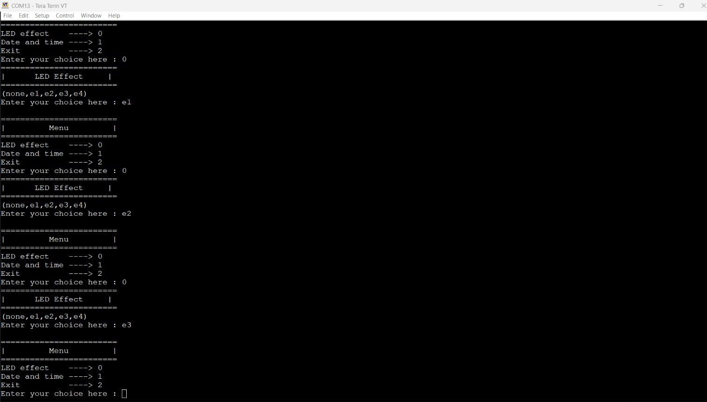
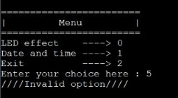
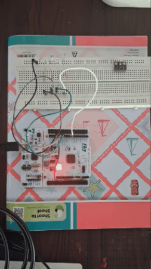
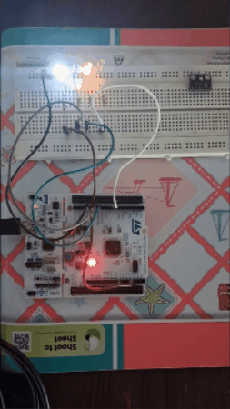
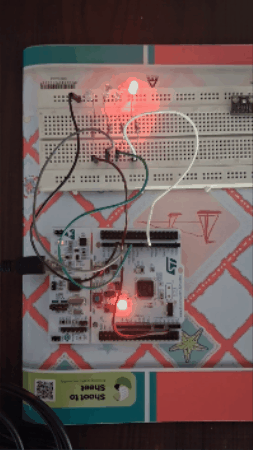
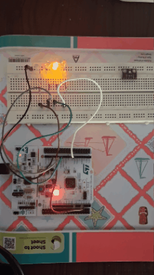
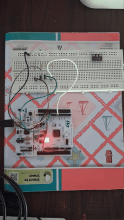
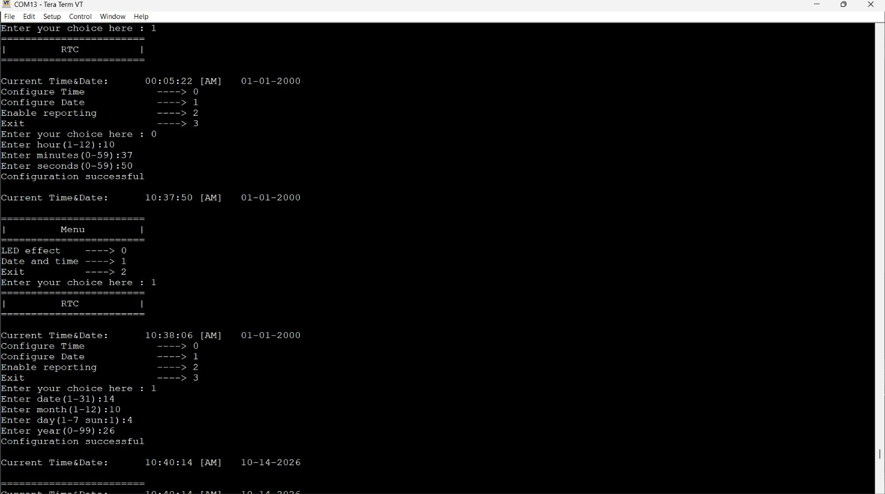
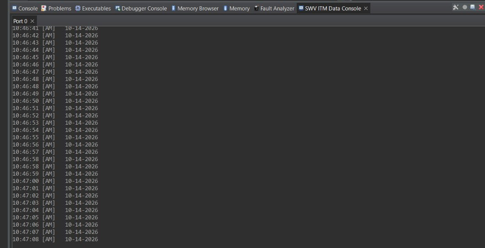

# FreeRTOS Command Console for STM32F446RE

A multi-task serial command-line application running on an STM32 Nucleo-F446RE. The system processes UART console commands to control software timer-driven LED patterns and configure or report calendar data from the on-chip RTC. Developed using native FreeRTOS APIs and the STM32 HAL in STM32CubeIDE, with runtime execution and task context switching profiled via SEGGER SystemView.

## Features

- **Menu-Driven UART Interface**: Interactive CLI over USART2 (Tera Term, 115200 baud, 8N1).
- **Safe ISR Ingestion Pipeline**: Byte-by-byte UART RX interrupt queuing (`xQueueSendFromISR`) with newline-triggered task notification (`xTaskNotifyFromISR`).
- **Input Validation**: Dedicated validation logic for command lengths, numeric ranges, and calendar constraints (e.g., hours 1–12, minutes/seconds 0–59, days 1–31, months 1–12).
- **Software Timer LED Control**: Four distinct blinking and running patterns (`e1`–`e4`) plus an idle state (`none`) driven by auto-reload FreeRTOS software timers (500 ms period).
- **On-Chip RTC Configuration**: Real-time interactive configuration of 12-hour AM/PM time and Gregorian date.
- **Dual Reporting Output**: Toggleable periodic 1-second RTC reporting over both UART and Cortex-M SWV/ITM (`printf` redirection via Port 0).
- **Gatekeeper Pattern**: A single `print_task` manages USART2 transmission, accepting string pointers via `q_print` to prevent interleaved console logs without mutex overhead.

## Hardware and Tools

| Item | Detail |
|---|---|
| Target Board | STM32 Nucleo-F446RE (ARM Cortex-M4F @ 84 MHz via HSI/PLL) |
| Timebase Source | TIM1 (dedicated HAL tick source to keep SysTick exclusive to FreeRTOS) |
| Toolchain & IDE | STM32CubeIDE (GCC) |
| Real-Time Kernel | FreeRTOS (Native API implementation) |
| Tracing & Telemetry | SEGGER SystemView, SWV ITM Data Console |
| Serial Terminal | Tera Term (115200 Baud, 8N1, Local Echo Enabled) |
| User Output LEDs | External LEDs connected to PA4, PA6, PA7, PA8 |

## Architecture & Code Structure

```text
008Queues_n_timers/
├── Core/
│   ├── Inc/
│   │   ├── FreeRTOSConfig.h         # FreeRTOS kernel configuration (preemption, tick rate, heap size)
│   │   ├── main.h                   # Global pin definitions, task handles, and queue prototypes
│   │   ├── stm32f4xx_hal_conf.h     # STM32 HAL module enablement configuration
│   │   └── stm32f4xx_it.h           # Interrupt handlers header
│   └── Src/
│       ├── main.c                   # Hardware init, RTOS tasks/queues/timers, UART RX ISR callback
│       ├── task_handler.c           # State machine, menu_task, led_task, rtc_task, cmd_handler_task, print_task
│       ├── led_effect.c             # Software timer callbacks and LED GPIO pattern generation
│       ├── rtc.c                    # RTC setup, input validation, and UART/ITM reporting
│       ├── stm32f4xx_it.c           # Peripheral interrupt service routines (USART2, TIM1)
│       ├── stm32f4xx_hal_msp.c      # Low-level HAL MSP initialization
│       ├── stm32f4xx_hal_timebase_tim.c # TIM1 tick timebase for HAL
│       ├── syscalls.c               # ITM/SWV printf redirection (_write implementation)
│       └── system_stm32f4xx.c       # CMSIS Cortex-M4 system clock setup
├── Drivers/                         # STM32F4xx HAL and CMSIS driver sources
├── common/ThirdParty/               # Third-party dependencies
│   ├── FreeRTOS/                    # FreeRTOS kernel source and portable ARM Cortex-M4 port
│   └── SEGGER/                      # SEGGER SystemView trace recording sources
├── docs/images/                     # Demonstration screenshots, diagrams, and effect GIFs
└── 008Queues_n_timers.ioc           # STM32CubeMX hardware, clock, and peripheral configuration
```

### FreeRTOS Primitives

| Primitive | Type | Size / Parameter | Description |
|---|---|---|---|
| `q_data` | Queue | 10 items &times; 1 byte | Ingests raw characters from `HAL_UART_RxCpltCallback` |
| `q_print` | Queue | 10 items &times; `size_t` (pointer) | Gatekeeper queue holding `const char*` message addresses |
| `handle_led_timer[4]` | Software Timers | 500 ms (auto-reload) | Invokes `led_effect_callback` to execute patterns `e1`–`e4` |
| `rtc_timer` | Software Timer | 1000 ms (auto-reload) | Triggers `rtc_report_callback` to stream timestamps over ITM |
| Task Notifications | Direct-to-Task | Bit/Value notifications | Synchronizes `cmd_handler_task` with active menu states |

### Task Breakdown

- **`cmd_handler_task` (Priority 2, Stack 250 words)**: Waits for ISR notification, extracts payload up to `\n`, adds null termination, and notifies the task matching `curr_state`.
- **`menu_task` (Priority 2, Stack 250 words)**: Displays the root menu and transitions states to LED control or RTC setup.
- **`led_task` (Priority 2, Stack 250 words)**: Evaluates effect arguments (`none`, `e1`–`e4`) and starts or stops the respective software timers.
- **`rtc_task` (Priority 2, Stack 250 words)**: Runs sub-state machine (`sRtcMenu`, `sRtcTimeConfig`, `sRtcDateConfig`, `sRtcReport`) to read user values, validate limits, and commit to RTC shadow registers.
- **`print_task` (Priority 2, Stack 250 words)**: Gatekeeper task that pulls string references from `q_print` and calls `HAL_UART_Transmit`.

## Demo

### Menu and LED Effect Selection


### Input Validation & Error Handling


### LED Effects
| Pattern 1 (`e1`) | Pattern 2 (`e2`) |
|---|---|
|  |  |

| Pattern 3 (`e3`) | Pattern 4 (`e4`) |
|---|---|
|  |  |

### Effects Off


### RTC Time and Date Configuration


### RTC Periodic Reporting
  


## What I Learned and Debugged

- **HardFault on RTOS Startup (NVIC Priority Grouping)**: In STM32CubeMX, the NVIC Priority Grouping was configured to the default of 0 bits for pre-emption priority and 4 bits for subpriority (`PRIGROUP=7`). Because FreeRTOS requires all interrupt priority bits to be allocated to pre-emption (4 bits for pre-emption priority, 0 bits for subpriority) to manage `BASEPRI` masking properly, the `SVC` instruction executing `vPortStartFirstTask` could not preempt and escalated to a HardFault (`HFSR.FORCED`). Fixed by setting the NVIC priority grouping to `NVIC_PRIORITYGROUP_4`.
- **Critical Section Imbalance**: Resolved a kernel freeze caused by an accidental unmatched `taskEXIT_CRITICAL()` call that corrupted the nesting counter assert (`uxCriticalNesting`).
- **UART Concurrency via Gatekeeper Pattern**: Prevented character interleaving and priority inversion by funneling all output through `print_task` via pointer queues instead of using blocking mutex primitives inside worker tasks.
- **Safe ISR Queue Handling**: Implemented full-queue recovery in `HAL_UART_RxCpltCallback` by discarding the oldest byte to preserve command line termination (`\n`) and yielding properly via FreeRTOS `FromISR` routines.

## Build and Run

1. Clone the repository:
   ```bash
   git clone https://github.com/sanjeevsiva-7/stm32-freertos-command-console.git
